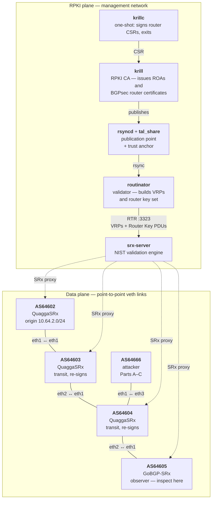
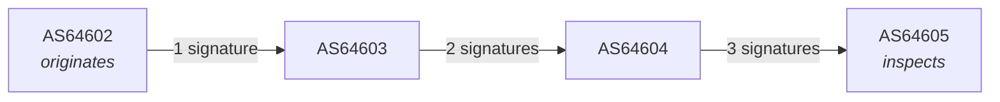

# BGPsec Teaching Lab — Containerlab Plan

A plan for building a Containerlab-based lab that simulates a small internet of
autonomous systems exchanging BGPsec-signed routes, intended as a learning tool
for students.

**Goal:** give students hands-on time with BGPsec and RPKI and the systems that
support them — a CA, a validator, an RTR feed, and routers that sign and verify.
Scope is deliberately those two technologies; ASPA is out of scope.

**Deliverable:** a single Jupyter notebook, `bgpsec-lab.ipynb`, containing
setup, exercises, and synthesis questions, which students run on their own
machines. Everything below is in service of that artifact — see §5.

---

## 1. Reality check (and why it's actually good pedagogy)

BGPsec is essentially undeployed. No hardware router implements it, and only
five software routers do — QuaggaSRx, GoBGP-SRx, ExaBGP-SRx, FRR, and BIRD.
SIDN Labs evaluated all five in 2025 and concluded they are "far from being able
to support BGPsec in production."

Concretely, from their interop matrix:

| Implementation | Signs | Validates | Notes |
|---|---|---|---|
| **QuaggaSRx** (NIST) | yes | full | Interoperates with everything — the safe backbone |
| **GoBGP-SRx** (NIST) | yes | full | No RTR integration |
| **ExaBGP-SRx** (NIST) | yes | partial | Doesn't log results or mark the RIB |
| **FRR** | yes | **broken** | Doesn't verify the SKI belongs to the signing AS. **Exclude.** |
| **BIRD** | yes | full | Crashes peers; needs patching. **Exclude.** |

That leaves the two NIST implementations, QuaggaSRx and GoBGP-SRx, as the lab's
routers. Both sign and validate fully and interoperate, which is all the lab
needs. FRR and BIRD stay in the table as context for why the field is this
narrow, but neither is built or deployed.

**Recommendation:** teach BGPsec as "what full path validation would look like,"
running on top of a real RPKI deployment rather than a stubbed one. RPKI is not
a side topic here — BGPsec router certificates live in the RPKI, so students
cannot get a route to validate without a working CA, publication point, and
validator. That makes ROV and the RTR feed something they operate directly, not
background scenery.

---

## 2. What we build on

Rather than starting from scratch, port [SIDN Labs' bgpsec-testbed][sidn] to
Containerlab. It already solves the hard parts: Dockerfiles for all five
routers (we build two of them), a working RPKI trust chain, and a certificate
generation script.

It ships as `docker-compose.yml` on a flat `10.0.0.0/24` bridge — Containerlab
is a genuine upgrade because point-to-point veth links let students `tcpdump` a
single inter-AS link and watch the `BGPsec_PATH` signature block grow one
signature per hop. On a shared bridge that's mush.

Supporting cast, all off-the-shelf:

- **Krill** — RPKI CA, issues BGPsec router certificates
- **Routinator** — validator, feeds routers over RTR
- **rsyncd** + **tal_share** — publication point + trust anchor distribution
- **SRx-Server** — NIST validation engine that QuaggaSRx delegates to

> ⚠️ **The main cost:** there are no prebuilt images. `nist/bgp-srx` is *not* on
> Docker Hub (verified — it 404s). Everything compiles from source. Budget real
> time for Phase 0 and plan to distribute images as a tarball; do **not** make
> 30 students each compile Quagga.

---

## 3. Proposed topology

Four ASes reusing SIDN's ASNs (`64602`–`64605`) so their certificates and
configs port directly, plus an attacker AS introduced in Phase 4:



Solid lines are BGP peerings on dedicated veth pairs — each is independently
capturable. Dotted lines are validation lookups: every router delegates to
`srx-server`, including AS64605, since GoBGP-SRx has no RTR client of its own.

The announcement travels left to right, accumulating one signature per AS:



This is the Phase 3 exit criterion and the object of the Part C capture: the
signature block count at AS64605 equals the hop count. On a shared bridge this
is unobservable, which is the whole argument for Containerlab in §2.

### Topology sketch

```yaml
name: bgpsec-lab

topology:
  kinds:
    linux:
      binds:
        - keys/:/var/lib/bgpsec-keys:ro

  nodes:
    rsyncd:
      kind: linux
      image: vimagick/rsyncd
      binds: [configs/rsyncd.conf:/etc/rsyncd.conf]

    krill:
      kind: linux
      image: nlnetlabs/krill
      healthcheck:
        test: ["CMD-SHELL", "wget -qO /dev/null http://localhost:3000/health"]
        start-period: 10
        interval: 5
      stages:
        create:
          wait-for: [{node: rsyncd, stage: create}]

    krillc:                          # one-shot: signs router CSRs, then exits
      kind: linux
      image: nlnetlabs/krill
      cmd: /bin/bash -c /opt/sign_csr.sh
      stages:
        create:
          wait-for: [{node: krill, stage: healthy}]

    routinator:
      kind: linux
      image: nlnetlabs/routinator
      stages:
        create:
          wait-for: [{node: krillc, stage: exit}]

    srx-server:                      # shared; all four routers proxy to it
      kind: linux
      image: bgpsec/srx-server:local
      stages:
        create:
          wait-for: [{node: routinator, stage: healthy}]

    as64602:
      kind: linux
      image: bgpsec/quaggasrx:local
      stages:
        create:
          wait-for: [{node: srx-server, stage: healthy}]

  links:
    - endpoints: ["as64602:eth1", "as64603:eth1"]
    - endpoints: ["as64603:eth2", "as64604:eth1"]
    - endpoints: ["as64604:eth2", "as64605:eth1"]
```

Containerlab's `stages` / `wait-for` maps cleanly onto Compose's `depends_on`,
including the `exit` stage for the one-shot `krillc` signer — the equivalent of
Compose's `service_completed_successfully`.

---

## 4. Phases

### Phase 0 — Host prep & image build

Docker 27.5.1 and Containerlab 0.77.0 are already installed on this host
(verified). Clone the testbed and build QuaggaSRx, GoBGP-SRx, SRx-Server, and
tal_share. Tag as `bgpsec/*:local`, then `docker save` a distributable tarball.

Dropping FRR and BIRD cuts two builds out of this phase, which is the longest
one.

**Bake `tcpdump` into the router images.** This is not a convenience — it is what
makes the notebook work without `sudo`. See §5.

*Exit criteria:* `docker images` shows all four images, and
`docker exec <node> tcpdump --version` succeeds.

### Phase 1 — Two-router smoke test

Port `topologies/two_routers/quaggasrx` to a `.clab.yml`. Generate keys via
`key_setup/create_certificates.sh topology_asns`, which emits EC keys,
self-signed BGPsec router certificates, and the ASN↔SKI pairs that the router
configs reference.

*Exit criteria:* a signed UPDATE validates as `Valid` end to end.

### Phase 2 — RPKI plane

Add the Krill → krillc → tal_share → routinator chain with proper staging.

*Exit criteria:* Routinator serves the testbed TAL over RTR and the routers show
a synced cache.

### Phase 3 — Four ASes

Full topology above, per-AS startup configs, plus a documented capture point per
link.

*Exit criteria:* signature count observed at AS64605 equals the hop count.

### Phase 4 — Curriculum

The requirement is that students understand *why* these systems exist, so the
arc is **break it first, then fix it in the order history did**. Every
protection is introduced only after students have watched the attack it stops
succeed against them. Nothing is presented as a feature; each is presented as a
response to a failure they just produced themselves.

The pivot is Part B → C. ROV is introduced, appears to solve hijacking, and is
then defeated in front of them by a forged path that ROV rates `Valid`. That
single moment is the argument for BGPsec, and it only lands because they ran
the ROV exercise first and believed it worked.

**Part A — The unprotected internet** *(validation off)*

1. Baseline reachability: AS64602 originates `10.64.2.0/24`; confirm AS64605
   uses it.
2. **Origin hijack.** AS64666 announces the same prefix. Being closer to
   AS64605, its route wins on path length. Traffic follows the attacker.
3. **Path forgery.** AS64666 announces a path claiming adjacency to AS64602 —
   the prefix now appears to originate from its true owner via a short path.
   Nothing objects.
4. Synthesis: *what did any router actually verify before accepting these?*

**Part B — RPKI and ROV** *(fixes origin)*

5. Tour the machinery: Krill (CA) → rsync publication point → Routinator
   (validator) → RTR → router table. Each hop inspected directly.
6. **ROA lifecycle.** Issue a ROA for `10.64.2.0/24`/AS64602 in Krill. Follow it
   through every stage above, including capturing the RTR PDU on the wire, and
   watch the prefix move `NotFound` → `Valid`. Withdraw it; watch it reverse.
7. Replay attack 2 — now `Invalid`, rejected.
8. **Replay attack 3 — still `Valid`.** ROV authorizes the (prefix, origin)
   pair, and the forged path names the correct origin. The attack survives.
9. Synthesis: *why is ROV structurally unable to see this?*

**Part C — BGPsec** *(fixes the path)*

10. Tour the added machinery: router keys, certificates, SKIs, and the Router
    Key PDUs that carry them over RTR.
11. Enable BGPsec. Capture an UPDATE and dissect `BGPsec_PATH`: signature blocks
    equal hop count, and the SKI in the block matches the one seen in the RTR
    Router Key PDU in step 10 — the same identity, observed on both wires.
12. Replay attack 3 — rejected. AS64666 cannot produce a signature under
    AS64602's key.
13. **Key revocation.** Revoke a router certificate in Krill; watch routes that
    were `Valid` become invalid without any change to the routers themselves.
14. Synthesis: *what exactly does each signature commit to, and why does it
    include the AS being sent to rather than just the sender?*

**Part D — Why this is not deployed** *(the honest ending)*

15. Partial deployment: a non-BGPsec AS in the middle of the path breaks the
    chain. Demonstrate by disabling BGPsec on AS64603 and observing what
    AS64605 can still prove.
16. Note the threat-model boundary: a route leak — a cryptographically valid
    path that violates business policy — is outside what BGPsec claims to stop.
17. Synthesis: *given Part A, why has essentially nobody deployed this?* Ties
    back to §1's reality check.

*Optional:* cost of signing, measured with NIST's BGPsec-IO traffic generator.

*Exit criteria:* each part ends in a verifiable machine state the notebook can
assert on, so students know they are set up correctly before answering.

### Phase 5 — The notebook

Assemble Phase 4 into `bgpsec-lab.ipynb`, the single deliverable. Details in §5.

*Exit criteria:* a student who has never seen the lab runs the notebook
top-to-bottom on a clean machine and reaches the end without external help.

---

## 5. The deliverable: `bgpsec-lab.ipynb`

One notebook that carries setup, exercises, and synthesis questions. Students
run it on their own machines.

### Kernel and cell strategy

Python 3 kernel with `%%bash` cells — no extra kernel to install, and Python
cells are available for parsing router output into assertions. Repeated
operations (wait for BGP convergence, read a validation state, capture and
dissect) go in a `labkit.py` helper imported at the top, so exercise cells stay
short enough to read as pedagogy rather than plumbing.

### The `sudo` problem, and why it is already solved

A password prompt inside a notebook cell hangs it with no visible prompt. Three
things would normally need root; all three are avoidable on a host prepared by
`quick-setup.sh`:

| Operation | Why no `sudo` is needed |
|---|---|
| `containerlab deploy` | The binary is installed **setuid root** (verified: `-rwsr-xr-x root root`) and students are in `clab_admins` |
| `docker …` | Students are in the `docker` group |
| Packet capture | `docker exec <node> tcpdump …` instead of `ip netns exec` — hence baking `tcpdump` into the images in Phase 0 |

This makes `docker exec` capture the *required* method, not a fallback.
`ip netns exec` stays in the instructor notes as a debugging tool.

> Group membership only takes effect after a re-login. The preflight cell must
> check this and say so plainly, because it is the single most likely place a
> student gets stuck at minute one.

### Packet inspection inside a notebook

Capture to a `.pcap` with `docker exec`, then dissect **inline with `tshark`**
so output appears in the notebook rather than in a GUI. Verified:

- BGPsec dissection has existed since **Wireshark 3.2.0**, so the Ubuntu 22.04
  `tshark` 3.6.2 package is sufficient — students do not need a current build.
- `tshark -Y 'bgp.update.path_attribute.bgpsec.ss.ski'` isolates signed updates;
  `-e` field extraction feeds the assertion cells directly.
- The GUI stays as an optional exploration step, with the `.pcap` written
  somewhere Windows can reach it.

### Structure

1. **Preflight** — one cell checking arch, RAM, Docker, Containerlab, group
   membership, and images. Fails loudly with the specific fix.
2. **Deploy** — load the image tarball, `containerlab deploy`, verify adjacency.
3. **Parts A–D** — Phase 4's arc, each exercise as: brief markdown framing →
   action cell → observation cell → assertion cell.
4. **Synthesis** — questions in markdown, answered in empty markdown cells.
5. **Teardown / reset.**

Assertion cells matter more than usual here: a student answering a synthesis
question from a lab that silently failed to converge learns the wrong thing.
Each check states what it verified in one line.

### Also shipped

`labkit.py`, the topology and configs, the image tarball, a reset script,
`clab graph` output, and a separate instructor notebook with answers and
expected outputs.

---

## 6. Risks

| Risk | Mitigation |
|---|---|
| Long build times, no prebuilt images | Build once, ship `docker save` tarball |
| BIRD crashes peers; FRR validates incorrectly | Both excluded — the lab runs on QuaggaSRx and GoBGP-SRx only |
| Group membership needs re-login | Preflight cell detects and explains it |
| WSL2 networking quirks | Validate in Phase 1; a real Linux VM is the fallback |
| Testbed is research-grade | Pin commits; treat breakage as a lesson, not a blocker |
| Students conflate lab TA with real RPKI | State loudly in the notebook: self-signed testbed trust anchor |

---

## 7. Assumptions

- Four ASes (interpreting "a few").
- All-software routers, since no hardware option exists.
- Students each run the lab locally rather than on a shared server.
- Students have Docker, Containerlab, and Jupyter, or can run `quick-setup.sh`.
- Linux or WSL2, **x86_64**. Images are built amd64-only.

If it is instead a shared multi-tenant server, Phase 5 changes: Containerlab
needs per-student lab name prefixes and management subnet separation. Worth
settling before Phase 3.

---

## 8. Sources

- [SIDN/bgpsec-testbed][sidn]
- [BGPsec — could you run it if you wanted to? (APNIC Blog, May 2025)](https://blog.apnic.net/2025/05/23/bgpsec-could-you-run-it-if-you-wanted-to/)
- [NIST BGP-SRx](https://github.com/usnistgov/NIST-BGP-SRx)
- [usnistgov/gobgpsrx](https://github.com/usnistgov/gobgpsrx)
- [RFC 8205 — BGPsec Protocol Specification](https://www.rfc-editor.org/rfc/rfc8205.html)
- [Containerlab — nodes reference](https://containerlab.dev/manual/nodes)

[sidn]: https://github.com/SIDN/bgpsec-testbed
